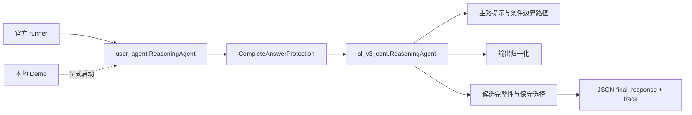

# 系统架构与边界

## 目标

本分支把同一条数学求解骨架包装成可验证的工程产品。官方评分仍由根目录 `user_agent.py` 接收平台注入的 `client`；本地 Demo 只是观察和演示表面。

## 调用图

`demo_server.py` 不在这条模块导入链上。它在收到请求时才创建本地 `InternChatClient` 和 `ReasoningAgent`，因此 `/health` 不需要凭证，启动 Demo 也不会改变官方运行配置。

## 默认开关

| 模块 | 官方默认 | 进入条件 |
| --- | --- | --- |
| 现有主路、有限条件边界路径、完整答案保护 | 保留当前快照 | 官方入口自动使用 |
| 本地 Web Demo | 关闭 | 显式运行 `python demo_server.py` |
| 未来的工具、记忆、题型路由、多智能体协作 | 关闭 | 新配置、独立测试和双轮评测后再讨论 |

## 证据边界

- 入口测试证明接口、JSON 序列化、失败回退和默认调用上限可达。
- Demo 测试证明页面、健康检查、输入校验和响应合同可达。
- 这些工程证据不证明隐藏题数学正确率，也不证明某个模块单独带来官方分数提升。
