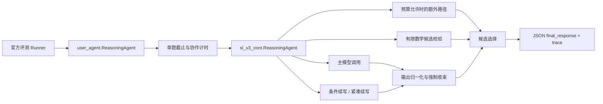

# V0.1 之前的官方评测 Agent 架构

**文档用途：** 记录主观评测 Workbench 建立前，项目用于官方答题评测的初始 Agent 架构。  
**适用范围：** 根目录 `user_agent.py` 及其官方候选实现。  
**基线依据：** `BASELINE.json`、当前官方入口和 `implementations/candidates/sl_v3_cont/`。

本文只描述当时真实存在的答题链路。后续的 LangGraph、DeepAgents、SQLite、工具注册、视觉输入和 Evidence Pack 不属于这套初始架构。

## 1. 初始目标

初始 Agent 的目标很窄：

1. 接收官方评测平台传入的数学题和 `client`；
2. 在平台允许的调用和时间范围内请求模型；
3. 对模型候选答案做有限的续写、校验和归一化；
4. 返回平台可以解析的 JSON 结果。

它是一个面向单题请求的答题组件，不是一个持久化的 Agent 应用服务。

## 2. 初始调用图



## 3. 根入口职责

根目录 [`user_agent.py`](../../user_agent.py) 是官方评测入口。它负责：

- 暴露 `ReasoningAgent`；
- 接收平台注入的 `client`；
- 读取单题预算；
- 在主线程可用时使用实时截止计时器；
- 调用 `sl_v3_cont.ReasoningAgent`；
- 在可选的答案先行路径启用时执行一次短预算尝试；
- 在主路径失败或截止时返回尽力而为的结果；
- 保持根入口的返回结构。

答案先行路径的默认开关是关闭的。它不能被理解为一个独立 Agent，也不能改变官方默认调用预算。

## 4. `sl_v3_cont` 候选实现

候选实现把一次请求拆成几个受预算约束的动作：

### 4.1 主路径

主路径通过官方 `client.chat(...)` 发起模型请求，捕获请求消息、响应、完成原因和本地诊断数据。模型调用仍是普通客户端调用，没有通用 Agent 框架提供的工具协议或图式运行时。

### 4.2 条件续写

当响应被截断、缺少完整答案或出现收束信号时，候选实现可以根据剩余时间尝试：

- 完整续写；
- 紧凑续写；
- 最终答案收束。

每次动作都检查剩余预算。无法安全开始下一次调用时，系统保留已有的最佳结果。

### 4.3 额外路径与候选选择

当预算和问题特征允许时，候选实现可以运行额外求解路径，并根据候选完整性、可解析性和有限校验结果选择一个答案。额外路径不是独立的持久化子 Agent，也没有跨请求记忆。

### 4.4 有限数学校验

`verifier.py` 对部分可识别的数学形式执行受限检查，例如：

- 方程根；
- 定积分；
- 求导；
- 极限；
- 线性方程组；
- 数值闭式结果。

校验使用 SymPy/mpmath 和受限表达式解析。无法匹配题型时返回未适用或未知，不把未知当成证明成功。

## 5. 输出与 trace

初始入口返回一个可 JSON 序列化的字典，核心字段包括：

```json
{
  "final_response": "...",
  "trace": [
    {
      "step": "...",
      "content": {}
    }
  ]
}
```

`final_response` 是官方平台需要读取的答案字段。`trace` 主要记录本题内的有限步骤、预算状态、候选选择和校验摘要。

这个 `trace` 不是事件数据库：

- 不保存可恢复的 Run；
- 不支持服务重启后查询；
- 不支持从任意阶段 resume；
- 不保存跨请求的 checkpoint；
- 不等同于 V0.1 的 Evidence Pack。

## 6. 预算与失败策略

初始 Agent 的资源控制以单题为单位：

- 单题时间截止；
- 模型调用次数和路径预算；
- 续写动作的最晚启动时间；
- 校验预算；
- 客户端失败后的有限回退。

当调用失败、预算不足或响应不完整时，系统优先保留已有的可解析答案，并在 trace 中记录状态。它不把失败任务保存为可继续的产品 Run。

## 7. 初始架构没有的能力

V0.1 之前的官方答题架构没有以下能力：

- LangGraph 或其他 Agent 编排框架；
- DeepAgents 角色级 Agent；
- Planner、Solver、Verifier、Synthesizer 的产品级角色分工；
- Tool Registry 和按需工具调用；
- Python 解释器工具；
- 文字加图片的多模态输入适配；
- SQLite Run、事件和 checkpoint；
- interrupt、resume 和人工复核；
- Evidence Pack 和运行回放；
- 展示 Profile 与官方 Profile 的产品级 API。

## 8. 与 V0.1 的关系

V0.1 不是把初始入口改造成另一个官方入口，而是在其外部建立 Showcase Profile：

```text
official Profile
  → 继续使用本文件描述的答题链路

showcase_mvp Profile
  → LangGraph Run
  → DeepAgents Agent
  → Tool Registry
  → Vision / Python Adapter
  → Evidence Pack
```

在 Showcase 中，当前官方 `ReasoningAgent` 可以作为一个 Solver Adapter 被调用。它的内部预算、输出归一化和有限校验仍属于官方答题组件；产品级 Run、事件、checkpoint、工具审计和导出由 Showcase 层负责。

## 9. 基线记录

`BASELINE.json` 记录的官方结果为：

| 日期 | 正确 | 错误 | 无效 |
| --- | ---: | ---: | ---: |
| 2026-10-11（北京时间） | 88 | 12 | 0 |

这个结果是该次官方评测的基线记录。它用于保护官方运行文件和行为，不单独证明某个内部模块的数学收益。

## 10. 追溯结论

初始项目的核心是“在严格单题预算内，通过多次受控模型调用、候选校验和输出收束，返回可解析答案”。

V0.1 增加的是产品运行层和展示层：可恢复 Run、图式编排、Agent 工具、视觉输入、计算工具、事件和证据导出。两者服务于不同评测目标，不能把 V0.1 的产品能力倒写成初始官方架构已经具备的能力。
