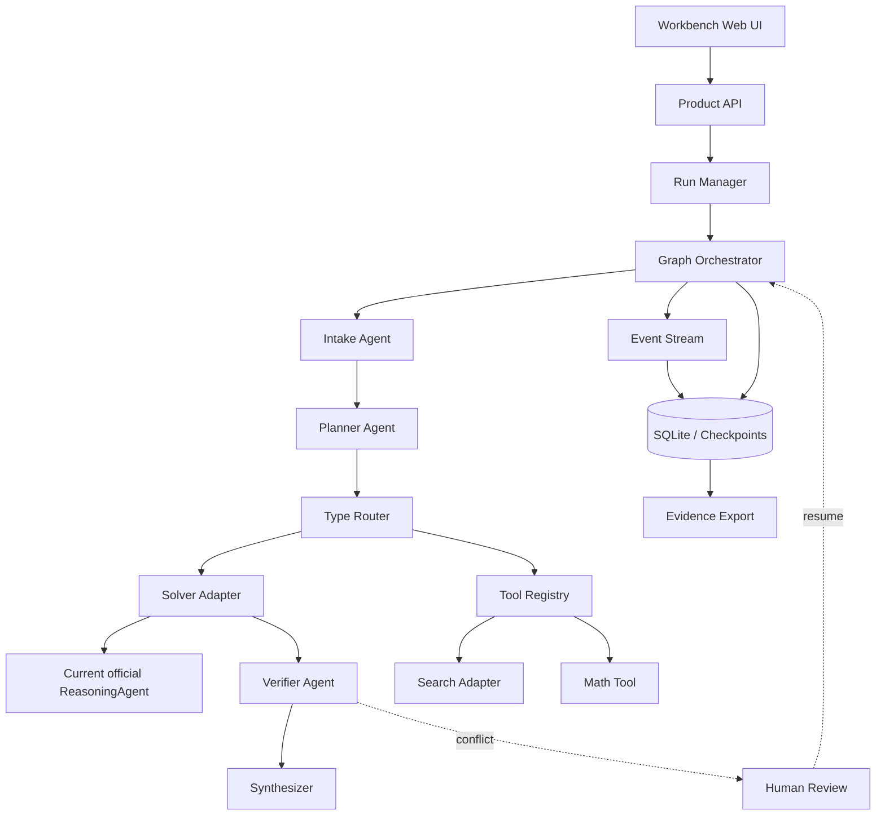

# 主观评测 Agent Workbench 技术架构文档

**状态：DRAFT，服务于 PRD 评审，不代表当前代码已经实现**

## 1. 设计原则

1. 官方评分链路和产品展示链路分离。
2. 以复杂数学任务的条件组织、证据检查和连续求解为架构主线，用真实流程呈现完整架构、稳定 Demo、创新机制和可复现证据。
3. 优先复用成熟开源项目的机制与实现模式，不同时堆叠多个框架。
4. 每个角色、工具和阶段都通过小接口连接，便于替换和测试。
5. 所有长运行、联网、工具调用和人工复核都必须有持久状态。

### 1.1 数学动机与工程亮点的逐项对应

下表是拟议设计的解释和验收方式。S＝系统设计 10 分，D＝展示质量 20 分，I＝创新与扩展性 10 分；一个模块可以支撑多项评分，但这些标记不是可相加的承诺分值。

| ID / 范围 | 数学任务中的困难 | 工程机制与责任 | 演示或验收证据 | 评分映射 |
| --- | --- | --- | --- | --- |
| H01 / MVP | 长任务中断后，已完成的求解阶段难以接续 | Run Manager 与 checkpoint 保存输入版本、已完成节点和检查结果 | 重启后恢复记录；修改条件后创建新运行，避免沿用失效结论 | S、D |
| H02 / MVP | 多条件、多小问容易遗漏或混淆依赖 | 图式规划和角色分工：每个子任务关联输入条件、目标和所需证据 | 子任务图、委派记录、未完成目标列表；检查角色实际执行 | S、I |
| H03 / MVP | 求解结论与校验意见可能冲突 | Solver / Verifier 分工；分别保存结论与检查依据 | 展示一条有定位依据的异议；检查器不适用时标记未知 | S、I |
| H04 / MVP | 定理名称、适用条件和外部资料可能被误用 | Search Adapter 返回来源，研究步骤核对引用及前提 | URL、检索时间、引用片段与待检查条件；搜索命中不等于证明正确 | S、D、I |
| H05 / MVP；MCP 为后续 | 计算结果需要独立工具检查，工具能力随任务而变 | Tool Registry 管理当前数学工具；后续通过 MCP 扩展工具连接 | 工具名、参数、版本、结果和支持范围；不将协议接入等同于数学验证 | S、I |
| H06 / P1 | 程序辅助推导和数值探索依赖运行环境 | Runtime Adapter 提供隔离计算环境和产物记录 | 复现代码、图表与环境版本；数值实验结果与严格证明分开 | S、D、I |
| H07 / P1 | 方法笔记难以跨研究任务复用，旧结论可能失效 | 项目级记忆保存来源、适用条件、版本和确认状态 | 展示检索理由与引用；新任务重新核对条件；官方 solve 不读取该记忆 | S、I |
| H08 / MVP | 错误、工具中断与无效循环难以定位 | 结构化事件、阶段时间线和调用成本关联同一个 Run | 展示卡住的步骤和错误类型；只展示可观察事件与摘要，不模拟模型内部思维 | S、D |
| H09 / MVP | 研究任务有歧义或需用户决定下一步 | interrupt / resume 保存复核请求和用户决定 | 条件澄清、批准重试及恢复记录；人工参与结果明确标记 | S、D |
| H10 / MVP | 对同一推导的复核需要重看原始依据 | 运行回放读取已有事件；重新执行另建 Run | 回放不调用模型或工具；重新执行不覆盖原记录；高级差异比较列入 P1 | S、D |
| H11 / MVP | 结论与推导、来源、工具检查容易脱节 | Synthesizer 与 Export 关联最终结论和证据 ID | 可读解答及 JSON / Markdown 导出；保留未验证内容和分歧 | S、D |
| H12 / MVP | 长推理与工具失败可能耗尽资源且丢失部分成果 | 统一产品预算、有限重试、部分结果交付和取消状态 | 超时后停止新调度并标记在途工作；不声称线程取消等于中止远端请求 | S、D |
| H13 / P2 | 失败复盘未形成可审查的方法改进 | Reflection / RSI 实验生成带版本的策略候选，经独立验证后讨论晋升 | 原策略、候选差异及验证记录；不自动重写官方入口或宣称自我进化收益 | I |

面向评审按“数学问题 → 求解困难 → 工程机制 → 实际记录”讲解；开源依赖名称放在实现说明中。对复用代码保留来源及许可，项目贡献聚焦数学任务的组织、集成和验证，通用框架能力不宣称为原创。

### 1.2 直接检查能力与工程支撑能力

条件检查、候选校验、定理依据核对属于面向正确性的设计；持久化、事件流、回放、界面和导出属于求解连续性与可复核性的支撑。两类能力共同组成产品，分别验收实际行为。未经对照验证不把任一模块的存在写成正确率提升，也不把产品模式演示归因到官方模式成绩。

本轮仅统一设计叙事，MVP / P1 / P2 边界继续以 [PRD](../prd/subjective-agent-platform-prd.md) 为准；表内 P1/P2 是后续规划。框架和组件选型仍待 PRD 评审及兼容性验证。

## 2. 参考项目与拟搬运机制

| 项目 | 一手资料中的机制 | 本项目采用方式 | MVP 状态 |
| --- | --- | --- | --- |
| LangGraph | 图式工作流、checkpointer、thread、store、interrupt/resume、故障恢复 | 作为首选主编排 Adapter；持久化和人工复核直接采用其模式 | 采用 |
| AutoGen GraphFlow | 有向图驱动的顺序、并行、条件和循环执行 | 借鉴多 Agent 图的执行语义；作为第二种工作流 Adapter 的预留接口 | 设计预留 |
| CrewAI Flows | 事件驱动 Flow、Memory、流式执行和 usage metrics | 借鉴事件驱动生命周期、Memory 接口和运行成本展示 | 部分采用 |
| CrewAI Tracing | Agent 决策、任务时间线、工具调用、LLM 调用和性能指标 | 采用本地结构化事件和可选 OpenTelemetry 导出 | MVP 本地实现 |
| OpenHands Runtime | Agent 与 Runtime 分离、EventStream、Docker Sandbox、插件注册、资源隔离和复现 | 采用 Runtime Adapter、事件流和插件契约；Docker 沙箱放 P1 | 接口预留 |

资料：

- [LangGraph Persistence](https://langchain-ai.github.io/langgraph/concepts/durable_execution/)
- [LangGraph Interrupts](https://langchain-ai.github.io/langgraph/concepts/breakpoints/)
- [AutoGen GraphFlow](https://microsoft.github.io/autogen/stable/user-guide/agentchat-user-guide/graph-flow.html)
- [CrewAI Flows](https://github.com/crewAIInc/crewAI/blob/main/docs/v1.14.7/en/concepts/flows.mdx)
- [CrewAI Tracing](https://github.com/crewAIInc/crewAI/blob/main/docs/edge/en/observability/tracing.mdx)
- [OpenHands Runtime Architecture](https://github.com/OpenHands/docs/blob/main/openhands/usage/architecture/runtime.mdx)

## 3. 总体架构



`OFFICIAL` 只作为一个 Solver Adapter 被产品层调用。根 `user_agent.py` 不导入 `API`、`GRAPH`、`TOOLS` 或 `STORE`。

## 4. 核心模块接口

### 4.1 Run Manager

```python
create_run(request) -> RunId
get_run(run_id) -> RunSnapshot
append_event(run_id, event) -> EventId
checkpoint(run_id, state) -> CheckpointId
resume(run_id, input) -> RunSnapshot
replay(run_id) -> ReplayResult
```

Run Manager 保存一次数学任务的条件版本、阶段成果和执行位置，为长任务恢复与解答复核提供持久记录；数学结论由求解和检查角色提供。

### 4.2 Graph Orchestrator

```python
execute(run_id, graph_profile) -> RunResult
interrupt(run_id, review_request) -> None
resume(run_id, decision) -> RunResult
```

MVP 只启用一个主图：

```text
Intake → Planner → Router → Solver → Verifier → Synthesizer
```

并行 Solver、Debate、Reflection 和循环图属于后续 Profile。

### 4.3 Agent Role

```python
class AgentRole(Protocol):
    name: str
    async def run(self, state: AgentState) -> RoleResult: ...
```

每个角色只能通过 `AgentState` 读写规定字段，不直接访问数据库、HTTP 请求或其他角色的私有状态。

### 4.4 Tool Adapter

```python
class ToolAdapter(Protocol):
    name: str
    capabilities: tuple[str, ...]
    async def invoke(self, request: ToolRequest) -> ToolResult: ...
```

ToolResult 必须包含状态、耗时、来源、摘要和错误类型。原始凭证和完整请求体不得进入事件日志。

## 5. 持久化模型

MVP 使用 SQLite；生产扩展可替换为 Postgres。表或集合包括：

- `workspaces`：项目和配置 Profile；
- `sessions`：用户会话；
- `runs`：一次任务执行；
- `run_stages`：阶段状态、开始/结束时间和错误；
- `events`：追加式事件流；
- `checkpoints`：可恢复的图状态；
- `agent_calls`：角色、模型、token、耗时和调用状态；
- `tool_calls`：工具、参数摘要、来源和结果状态；
- `artifacts`：JSON、Markdown、图表和导出包索引；
- `review_requests`：等待人工决定的请求。

题目原文可保存在受访问控制的运行记录中；前端和导出文件默认显示哈希、摘要和脱敏字段。

## 6. 状态机

```text
RECEIVED
  → PLANNING
  → ROUTING
  → RUNNING
  → VERIFYING
  → SYNTHESIZING
  → COMPLETED

RUNNING / VERIFYING
  → NEEDS_REVIEW
  → RESUMED
  → RUNNING

任意阶段
  → RETRYING
  → FAILED
  → REPLAYABLE
```

每个状态变化都产生事件。前端不通过猜测请求是否结束来显示进度，而是读取事件和 checkpoint。

## 7. API 设计

- `POST /api/workspaces`：创建产品工作空间；
- `POST /api/sessions`：创建会话；
- `POST /api/runs`：创建运行并返回 `run_id`；
- `GET /api/runs/{run_id}`：查看运行快照；
- `GET /api/runs/{run_id}/events`：SSE 事件流；
- `POST /api/runs/{run_id}/resume`：恢复中断的运行；
- `POST /api/runs/{run_id}/replay`：按原配置回放；
- `GET /api/runs/{run_id}/export`：下载证据包；
- `GET /api/capabilities`：展示当前 Profile 的角色、工具和开关；
- `GET /health`：检查存储、编排器、搜索和工具注册状态。

原有 `/solve` 保留为兼容入口，由产品层转成一次同步 Run；官方平台不调用这些 API。

## 8. 运行 Profile

### `official`

- 只存在根 `user_agent.py`；
- 产品侧车关闭；
- 不联网、不读产品数据库、不使用答案库；
- 继续沿用当前官方调用和 token 预算。

### `showcase_mvp`

- 启用 Graph Orchestrator、SQLite、SSE、Search Adapter、Math Tool、Review 和 Export；
- 使用当前官方 Agent 作为 Solver Adapter；
- 承载条件整理、研究检索、协作检查与解答交付，使用独立产品预算；产物用于研究和演示，单独记录产品模式及实际启用的模块。

### `research_experimental`

- 允许多 Solver、Debate、Reflection、长期记忆和沙箱 Adapter；
- 需要单独记录成本、失败率和数据流；
- 不自动合入 `official`。

## 9. 安全与可靠性

- 搜索、文件、代码和外部 API 通过 allowlist；
- 每个 Run 有最大时间、角色调用数、工具调用数和 token 预算；
- 工具超时采用显式失败，不无限重试；
- 人工复核前持久化 checkpoint；
- 事件和导出结果执行敏感字段脱敏；
- 沙箱执行使用 OpenHands 风格的 Runtime Adapter，默认关闭；
- replay 模式必须标注来源和时间，不能伪装成实时模型结果。

## 10. 测试和证据

### 单元测试

- 状态机转移和非法转移；
- checkpoint 保存与恢复；
- 角色契约；
- ToolResult 脱敏；
- 预算和超时；
- replay 与 export。

### 集成测试

- 真实官方 Solver Adapter；
- 搜索 Adapter 成功、超时和空结果；
- 人工复核暂停和恢复；
- 页面刷新后查询历史 Run；
- clean environment 安装和启动。

### 主观评测证据

| 评分项 | 技术证据 |
| --- | --- |
| 系统设计 10 | 图式编排、角色契约、状态机、持久化、checkpoint、工具权限、失败恢复 |
| 展示质量 20 | Workbench、SSE 时间线、故障场景、回放、导出、视频和技术报告 |
| 创新扩展 10 | GraphFlow 式条件/并行流程、Researcher、Tool Registry、Review、Runtime Plugin Adapter |

## 11. 迁移和合并策略

第一阶段只新增产品侧车和文档。第二阶段在独立 Profile 中启用 MVP。只有经过干净环境入口验收、Demo 验收和官方路径差异审查后，才讨论是否把某个模块移入默认评分配置。

绝不把四个成熟框架全部作为运行时依赖。主编排只选择一个实现，其余项目的亮点通过接口、数据模型和适配器吸收。

## 12. MVP 技术选型

为避免把多个框架同时塞进运行时，MVP 采用单一主编排实现：

| 层 | MVP 选择 | 选择原因 |
| --- | --- | --- |
| Web API | FastAPI | 提供类型化请求、SSE 和清晰的健康检查接口 |
| 编排 | LangGraph | 直接复用状态图、checkpoint、thread、interrupt/resume |
| 持久化 | SQLite | 单机 Demo 易复现，后续可替换为 Postgres |
| 前端 | React + Vite | 适合运行时间线、事件流、复核面板和结果对比 |
| 搜索 | `SearchAdapter` + 一个可配置供应商 | 保留来源、缓存、超时和凭证边界 |
| 事件流 | SSE | MVP 足以支持阶段时间线，后续可升级 WebSocket |
| 观测 | 本地结构化事件；OpenTelemetry 导出为可选 Adapter | 先保证脱敏和可回放，再接入外部平台 |
| 沙箱 | Runtime Adapter 接口 | 复用 OpenHands 的隔离思路，Docker 执行放入 P1 |

AutoGen GraphFlow、CrewAI Flow 和 OpenHands Runtime 不作为 MVP 的额外运行时依赖；它们的结构化编排、事件、Memory、Tracing、Runtime 和插件机制通过接口和数据模型吸收。

## 13. MVP 交付顺序

1. 数据模型、Run Manager 和 SQLite；
2. LangGraph 主图与当前官方 Solver Adapter；
3. 阶段事件、SSE 和 Workbench 页面；
4. Search Adapter、Math Tool 和 Tool Registry；
5. checkpoint、人工复核、resume 和 replay；
6. JSON/Markdown 证据导出；
7. 三个固定场景、故障演示和评分证据材料。

每一步都必须能独立运行和回放；没有完整的阶段证据就不进入下一步。
